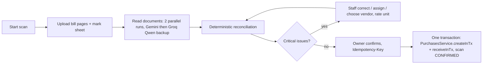

# AI Consignment Scanner

Purchases → **Scan Consignment** turns a photographed vendor bill (patti) and the handwritten mark sheet into a
reviewed, reconciled draft that the Owner confirms into an ordinary vendor bill + lot receipt. The AI only transcribes;
every number that matters is checked by deterministic code, and nothing touches stock until the Owner confirms.

Related: [extraction design](scanner-extraction-design.md) · [reconciliation engine](scanner-reconciliation-engine.md) ·
[database](scanner-database-design.md) · [prompts](scanner-prompt-management.md) · [API](scanner-api.md) ·
[evaluation](scanner-evaluation.md) · [configuration](scanner-configuration.md).

## Flow

**Getting documents in:** each document box has **Scan** (opens the phone's rear camera, one page per shot), **Upload**
(pick many photos/files at once) and drag-and-drop. Files are sent one per request in order; a refused file does not stop
the rest, and the screen lists which were not added.

| Status | Meaning |
|---|---|
| `DRAFT` | Created; documents can be uploaded |
| `PROCESSING` | Runs in flight (stale after `(retries+1)×(timeout+5s)+60s`, then it can be read again) |
| `NEEDS_REVIEW` | At least one CRITICAL issue |
| `READY` | No CRITICAL issue; Owner may confirm |
| `FAILED` | Every run failed; retry with "Read again" |
| `CONFIRMED` | Purchase posted; the scan row is frozen by a trigger |

## Design decisions (and why)

| Decision | Why |
|---|---|
| Files stored as `bytea` in Postgres (`consignment_scan_files`), served through 10-minute HMAC-signed links | No storage infrastructure existed; this is private, organization-scoped, transactional and works on Vercel (no local disk). `shortcut:` move to a private S3-compatible bucket when volume grows (the file table is the only place to change). |
| Processing runs inside the `POST /process` request (both jobs in parallel), progress persisted per run | No queue/Redis needed; works on Vercel (a function keeps running until it responds) and on a long-running Node. The UI polls `GET` every 2 s, so a reload or a second screen shows the same server state. |
| Confirm reuses `PurchasesService.createInTx` / `receiveInTx` | One copy of pricing, lot/mark composition, costing and stock posting. They were split out of `create`/`receive` so both run in one transaction. |
| One purchase line per mark; per printed rate for a range mark (`OK460`, `OK470`) | A purchase line has one rate and amounts must add up exactly — averaging a range would change money. |
| All bill charges become purchase expenses (payable); "Add to lot cost" also passes a charge to receiving as a weight-allocated costing expense | Keeps payable and landed cost separate. Driver Advance defaults to *not* in cost (it is a cash advance, not an inventory cost). |
| Rate convention stored on the scan, remembered on the vendor (`vendors.bill_rate_unit`) after the first confirm | Vendors differ (per kg / per 10 kg / per bag); the printed amounts prove which (evidence shown). |

## Phase 0 audit — affected-file inventory

| Area | Existing (before) | Change |
|---|---|---|
| Purchases | `purchases.service.ts` create/receive each opened their own transaction | Split into `createInTx`/`receiveInTx` (behaviour unchanged; 14 purchase e2e tests still pass) |
| Receiving / "Calculate Final Rates" | `receiving.calc.ts` (server-authoritative) | Reused unchanged via `receiveInTx` |
| Vendors | no rate convention | `vendors.bill_rate_unit` (nullable) |
| Settings / env | no AI config | `env.ts` `gemini.*` |
| File upload | none existed | multer (already bundled with `@nestjs/platform-express`), memory storage, `file-validation.ts` |
| Auth | global `AuthGuard`, `@Roles` | confirm `@Roles('OWNER')`; file route `@Public` but signature-checked |
| New module | — | `src/modules/consignment-scans/**` |
| Frontend | Purchases list, Receive Lot | `Scan Consignment` button; `/purchases/scan`, `/purchases/scan/[id]`; `api/consignment-scans.api.ts`; hooks; `client.ts` no JSON content-type for `FormData` |
| Database | — | migration `20261031000000_consignment_scanner` |

## Known limitations

- **Per-bag bills cannot be confirmed yet**: purchase lines are priced per kg (`RATE_UNIT_PER_BAG_UNSUPPORTED`). Reconciliation supports them.
- **Rounding**: purchase lines round to whole rupees (existing rule shared with sales), so the recorded payable can differ from the vendor's paise total (reference bill: +₹1.30). Shown as a `ROUNDING_DIFFERENCE` warning and in the confirm dialog. Owner decision pending (see questions-for-owner).
- **Confirm assumes everything billed arrived** (received = billed, no defects). Shortages need a stock adjustment afterwards, or use the manual Receive Lot flow instead.
- **Vercel**: request bodies are capped (~4.5 MB) — the UI uploads one file per request; set the function max duration ≥ 120 s for `/process`.
- A handwritten mark misread with HIGH confidence is possible (measured: "EG" → "EB"); review the mark column against the photo.
- HEIC photos are accepted and sent to Gemini but browsers cannot preview them (use Open).
