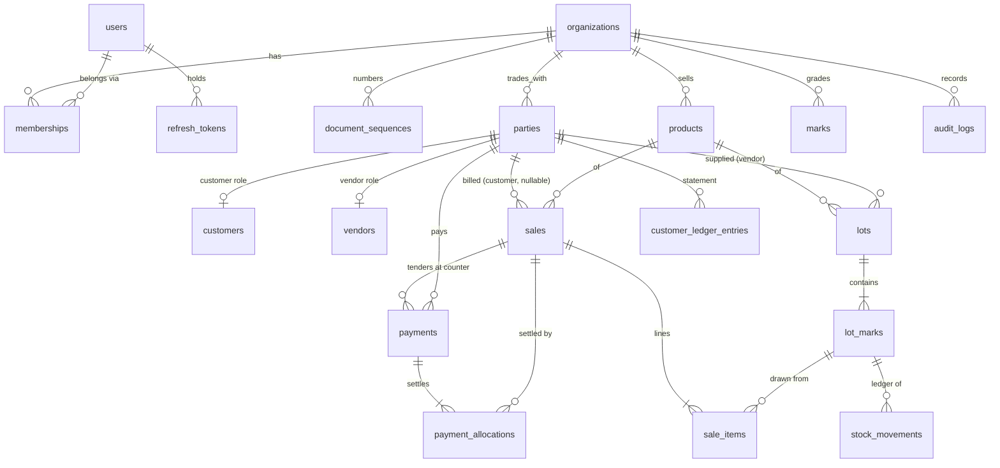

# Database Design

PostgreSQL 18 on Neon (dev branch `ep-odd-flower`; production `ep-round-bar` has no schema yet). Tests run on a local Postgres 17.
Source of truth: `prisma/schema.prisma`. Migrations: `prisma/migrations/` (SQL, committed, applied by `npm run db:migrate` on the direct URL).

## ER diagram



## Tables

| Table | Purpose | Key columns | Integrity |
|---|---|---|---|
| organizations | Tenant + company profile + sale charge settings | slug, shop_name, timezone, invoice/receipt prefix, amali/market fee ₹/bag + toggles | slug unique; charges ≥ 0 |
| users | Login identity (global) | username, password_hash (scrypt), active | lower(username) unique |
| memberships | User ↔ organization with role | role OWNER/MANAGER/SALESPERSON | PK(user, org) |
| refresh_tokens | Rotating refresh tokens | token_hash (sha256), family_id, expires_at, revoked_at | token_hash unique |
| document_sequences | Gap-free numbers | (org, kind) → next_value; kinds INVOICE, RECEIPT, CUSTOMER, VENDOR | PK(org, kind) |
| parties | One business | name, phone, email, address, location | — |
| customers | Customer role of a party | code CUST-###, credit_limit, credit_days, kind, status | (org, code) unique; limit ≥ 0; days 0–365 |
| vendors | Vendor role of a party | code VEN-###, status | (org, code) unique |
| products | Onions, Garlic, … | code, name, status | (org, code), (org, lower(name)) unique |
| marks | Quality master + floor rates | code, default selling/purchase rate, grade | (org, upper(code)) unique; rates ≥ 0 |
| lots | Consignment | lot_number, product, vendor party, purchase bill no, arrival_date | (org, upper(lot_number)) unique |
| lot_marks | **Current stock** per lot+mark | initial/remaining bags & kg, purchase rate, finalized/calculated/override selling rate | (lot, upper(mark_code)) unique; all quantities ≥ 0 |
| stock_movements | **Immutable stock ledger** | type, signed bags_delta / weight_delta_kg, balance after, reference, actor | sign CHECK per type; non-zero; append-only trigger |
| sales | Bill header + charge snapshot | bill_number, customer snapshot, sale_date, totals, Amali/fee rates+amounts, payment_type, credit_days, due_date, status, idempotency_key | (org, bill) unique; (org, idempotency_key) unique; total > 0 and = subtotal + charges |
| sale_items | Bill lines | lot_mark, lot/mark snapshot, bags, kg, ₹/kg, amount, bag_weights jsonb | bags, kg, rate > 0 |
| payments | Receipts | receipt_number, customer (null = counter sale), amount, method, reference, sale_id (counter tender), previous/new outstanding snapshot, idempotency_key | (org, receipt) unique; amount > 0 |
| payment_allocations | Receipt → bill (null = opening balance) | amount | amount > 0; append-only |
| customer_ledger_entries | **Receivables ledger** | type OPENING/SALE/PAYMENT/ADJUSTMENT, debit, credit, reference | exactly one of debit/credit > 0; append-only |
| audit_logs | Business & security events | actor snapshot, action, entity, details, metadata jsonb | append-only |

Types: money `numeric(14,2)`, kg `numeric(12,3)`, rates `numeric(10,2)`. App arithmetic uses integer paise and
grams (`src/common/money.ts`); line amount = `round(kg × ₹/kg)` to the whole rupee, half up (frontend rule).

### Data dictionary — derived values (never stored twice)

| Value | Definition |
|---|---|
| Customer outstanding | `Σ(debit − credit)` of `customer_ledger_entries` for the party |
| Bill paid amount | `Σ payment_allocations.amount` for the sale |
| Bill balance due | `total_amount − paid` (0 when CANCELLED) |
| Bill payment status | PAID / PARTIAL / CREDIT from paid vs total |
| Lot totals | `Σ` over its `lot_marks`; status EXHAUSTED when remaining bags = 0 |
| Opening balance unpaid | OPENING debits − allocations with `sale_id IS NULL` |

## Indexes and the queries they serve

| Index | Query |
|---|---|
| sales (org, sale_date) | date-range bill lists, daily totals |
| sales (customer_party_id) | open bills for a customer during payment allocation |
| payment_allocations (sale_id) | per-bill paid amount (correlated subquery) |
| payments (org, received_on), (customer) | collections by day, customer receipts |
| customer_ledger_entries (customer, entry_date, created_at) | outstanding, running balance window |
| stock_movements (org, created_at), (lot_mark_id) | movement history, reconciliation |
| unique business keys above | duplicate prevention, idempotency |

Query plans were not measured: the dev data set is 14 lot-marks and 4 customers, where Postgres correctly
sequential-scans. Re-check with `EXPLAIN (ANALYZE, BUFFERS)` once real volume exists (`performance-strategy.md`).

## Transaction boundaries

All in one `READ COMMITTED` transaction each; lock order is always **customer row → document sequence → lot-mark
rows sorted by id**, so concurrent bills cannot deadlock.

| Operation | Inside the transaction |
|---|---|
| Post sale | lock customer (`FOR UPDATE`); price & settle; allocate bill number; insert sale + lines; per lot-mark conditional decrement + SALE_OUT movement; ledger SALE debit; per tender: receipt number, payment, allocation, ledger credit; audit |
| Record payment | lock customer; outstanding from ledger; reject if amount > outstanding; plan allocation; receipt number; payment + allocations + ledger credit; audit |
| Cancel sale | lock sale; require no allocations; SALE_REVERSAL movements; ledger ADJUSTMENT credit; status CANCELLED; audit |
| Stock adjustment / opening | conditional update + movement; audit |
| Settings / customer / vendor / user changes | row change + audit |

### Concurrency: no overselling

```sql
UPDATE lot_marks
   SET remaining_bags = remaining_bags + $bagsDelta,
       remaining_weight_kg = remaining_weight_kg + $kgDelta
 WHERE id = $id AND organization_id = $org
   AND remaining_bags + $bagsDelta >= 0
   AND remaining_weight_kg + $kgDelta >= 0
RETURNING remaining_bags, remaining_weight_kg;   -- 0 rows ⇒ 409, whole bill rolls back
```

The check and the write are one statement under the row lock, so a stale read cannot oversell. Verified by the
e2e test that fires 5 concurrent 6-bag bills at a 20-bag mark: exactly 3 succeed, 2 get 409, stock ends at 2.

### Reconciliation (`src/database/reconciliation.ts`)

- **Stock:** for every lot-mark, `remaining = Σ movement deltas` (bags and kg).
- **Receivables:** for every customer, `ledger outstanding = unpaid opening + Σ unpaid confirmed bills`.

Both return the drifting rows; both run after every e2e test and returned none on the dev database after a
bill was posted from the browser.

## Migrations

- `20261025000000_init` — schema; `20261025000100_integrity` — CHECK constraints and append-only triggers (stock_movements,
  customer_ledger_entries, payment_allocations, payments, audit_logs); `20261025120000_purchases` — costing masters, purchases,
  purchase items/expenses, `organizations.default_selling_margin_per_kg`, `lots.purchase_id` FK, purchase integrity rules.
- New change: edit `schema.prisma` → apply existing migrations to a **scratch** database → `prisma migrate diff
  --from-config-datasource --to-schema prisma/schema.prisma --script` → save as a new migration folder and append CHECKs/triggers by hand
  → `prisma migrate diff … --exit-code` must report no difference → commit → `npm run db:migrate`.
- Never `prisma db push` or `migrate reset` against shared databases. Prefer additive, backward-compatible changes; there are no
  down migrations — recover forward, or restore a Neon branch / point-in-time snapshot for a bad deploy.
- Test migrations on a Neon branch of production before applying to production.

## Seed

`npm run db:seed` (refuses `NODE_ENV=production`) loads `src/database/seeds/dev-fixture.json`, generated from the
frontend mock seed: 3 users (password from `SEED_USER_PASSWORD`), 6 marks, 3 products, 4 customers with opening
balances (₹4,90,000 total), 3 vendors, 9 lots / 14 lot-marks with OPENING_STOCK movements (735 bags, 35,335 kg),
10 costing expense types, and the 9 legacy vendor bills (RECEIVED, empty receiving record, linked to their lots; vendor totals
₹7,08,500 / ₹5,94,800 / ₹10,06,800).
Next numbers: VPN-INV-1085, VPN-REC-510, CUST-005, VEN-004. Historic mock bills are not imported; their effect is
inside the opening balances and remaining stock.

## Phase 7 tables

| Table | Purpose | Key constraints |
|---|---|---|
| `costing_expense_types` | Cost master; kind `PURCHASE` (owed to vendor) or `STOCK_RECEIVING` (paid at arrival) | unique (org, kind, name) |
| `selling_margin_components` | Extra ₹/kg added to the selling rate | unique (org, name); `per_kg >= 0` |
| `purchases` | Vendor consignment bill: gross, purchase expenses, net owed; `receipt_status`; `receiving_record` JSON written once | unique (org, vendor, bill_number); `net = gross + expenses`; `RECEIVED ⇔ receiving_record and received_at set`; lot number upper-case; **trigger**: a received purchase cannot change, no purchase can be deleted |
| `purchase_items` | Bill lines (mark, bags, kg, rate, line amount) | positive bags/kg; append-only trigger |
| `purchase_expenses` | Bill charges with the name copied at billing time (`expense_type_id` null for a custom charge) | `amount >= 0`; append-only trigger |

`organizations.default_selling_margin_per_kg` (default 6) is the costing setting; the rounding rule is fixed (`CEIL_WHOLE_RUPEE`).
`lots.purchase_id` points at the purchase that created the lot (later purchases of the same lot number extend it).
`purchaseDrift` in `src/database/reconciliation.ts` checks PURCHASE_IN bags against each received purchase's recorded groups.
