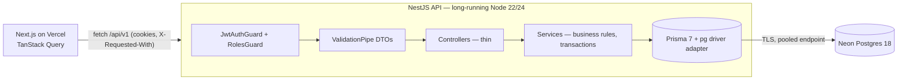

# System Architecture

## Shape

One NestJS **modular monolith** talking to one Neon PostgreSQL database. Sales, stock, receipts and ledger
must commit together, which a single database transaction does and a set of services cannot do cheaply.
No Redis, queue or object store yet: nothing in the current screens needs them (see `performance-strategy.md`).



Request flow: controller → guards (JWT, role) → DTO validation → service (pure calculators in
`*.calc.ts` + one DB transaction) → Prisma → Postgres → explicit response mapper → JSON.

## Decisions

| Decision | Choice | Why |
|---|---|---|
| Backend location | Separate repo `VedhaPremShop-BE` | FE README says the API lives in a separate repository; the repo already exists. |
| Framework | NestJS 11 on Node 22 LTS (runs on 24) | Requested; DI, guards, pipes, Swagger out of the box. |
| ORM | **Prisma 7.10.1** (`@prisma/client` + `@prisma/adapter-pg`) | Owner's instruction (session 2). Session 1 used Drizzle; replaced. Raw SQL (`$queryRaw`) is used where Prisma has no equivalent: `FOR UPDATE` locks, conditional `UPDATE … RETURNING` stock changes, ledger aggregates. |
| Validation | `class-validator` DTOs + global `ValidationPipe({ whitelist, transform })` | Nest standard; feeds Swagger. Unknown fields are stripped (FE sends whole `Sale` objects). |
| Auth | JWT access token (15 min) + rotating opaque refresh token (30 d, hashed in DB), both httpOnly cookies; `Authorization: Bearer` also accepted | No tokens in localStorage. Rotation + reuse detection. |
| Password hashing | `node:crypto` scrypt (N=2^15, r=8, p=1) | Memory-hard, OWASP-acceptable, zero native dependency. |
| Logging | Nest `ConsoleLogger({ json: true })` + request-id middleware | Structured JSON without another library. |
| API style | REST, `/api/v1`, plain arrays matching `src/types` | Keeps every existing screen working unchanged. |
| Money / weight | Postgres `numeric(14,2)` / `numeric(12,3)`; app arithmetic in integer paise / grams | No float rounding in authoritative amounts. |
| Tenancy | `organization_id` on every business row, taken from the JWT, never from the request | See below. |

### Prisma vs Drizzle

| | Prisma 6/7 | Drizzle 0.44 |
|---|---|---|
| Schema & migrations | Own DSL, generated SQL, good DX | TS schema, `drizzle-kit generate` emits plain reviewable SQL |
| CHECK constraints, partial/expression indexes | Not in the DSL; hand-edit migrations | Native in schema (`check()`, `uniqueIndex().on(sql…)`) |
| Row locks / conditional updates (`FOR UPDATE`, `UPDATE … WHERE remaining >= x RETURNING`) | `$queryRaw` | First-class query builder (`.for('update')`, `.returning()`) |
| Runtime | Query engine / driver-adapter churn in v7 | Thin layer over `pg` |
| Types | Excellent | Excellent, inferred from schema |

Session 1 chose Drizzle for the locked, conditional writes; the owner then required Prisma. Those writes are now `$queryRaw` inside
`$transaction` (see `modules/inventory/stock-ledger.ts`, `modules/sales/billing.ts`). CHECK constraints and append-only triggers
live in hand-written migration SQL, which `prisma migrate diff` leaves alone. Prisma is used for everything (no second ORM).

## Tenancy and the distribution hierarchy

- Every business table has `organization_id`; every query filters on the caller's `orgId` claim.
  A record from another organization is indistinguishable from a missing one (404).
- A user belongs to organizations through `memberships(user_id, organization_id, role)`; the token carries one org.
- Upstream vendors and downstream customers are **parties** of the organization. A business that is both is one
  party with a customer profile and a vendor profile.
- The multi-level hierarchy (producer → wholesaler → distributor → us → retailer) is represented by parties today.
  When a second distributor needs its own books, it becomes another organization; cross-organization trading
  would then link a party to an organization (`parties.linked_organization_id`) — not built now because no
  screen or second tenant exists (YAGNI, documented).
- Postgres RLS is not enabled: the app connects through a pooled role and scopes in code, covered by isolation
  tests. RLS (`SET LOCAL app.org_id` per transaction) is the planned defence-in-depth step before a second tenant.

## Folder structure

```
VedhaPremShop-BE/
  src/
    main.ts                 bootstrap: prefix /api/v1, CORS allowlist, cookies, pipes, filters, Swagger
    app.module.ts
    config/env.ts           typed, validated process.env (fails fast)
    common/                 only code used by 2+ modules
      auth/                 JwtAuthGuard, RolesGuard, @Roles, @CurrentUser, @Public
      http/                 exception filter, request-id middleware
      money.ts              paise/gram integer helpers, line amount
      dates.ts              org-timezone business date/time
      sequences.ts          gap-free bill/receipt numbers
      audit.ts              AuditService (write inside the caller's transaction)
    database/
      prisma.service.ts     one pg pool via the Prisma driver adapter (PrismaService, TX_OPTIONS)
      reconciliation.ts     stock / receivable / counter-cash / purchase drift queries
      seed.ts               dev-only seed from seeds/dev-fixture.json
    modules/
      auth/  users/  settings/ (+ costing)  customers/  vendors/  inventory/  purchases/  sales/ (+ approvals)  payments/  reports/  audit/
        <name>.module.ts, <name>.controller.ts, <name>.service.ts, dto.ts, <name>.calc.ts (pure rules, unit-tested)
    health/health.controller.ts
  test/                     e2e + integration (real Postgres)
  scripts/bootstrap-admin.ts
  docs/
```

Modules merged where the dependency graph says so: `invoices` lives in `sales` (an invoice *is* the confirmed
sale); `receivables` lives in `customers` (ledger) + `payments` (allocations); `stock-movements` lives in
`inventory`; `suppliers` = `vendors` (frontend term). `purchases`, `dashboard`, `reports` arrive in Phases 7–8.

Shared-code rule: a helper moves to `common/` only when a second module needs the *same* behaviour. Sale charge
and settlement rules stay in `sales/sales.calc.ts`; allocation in `payments/allocation.calc.ts`.
</content>
</invoke>
